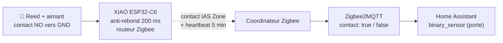
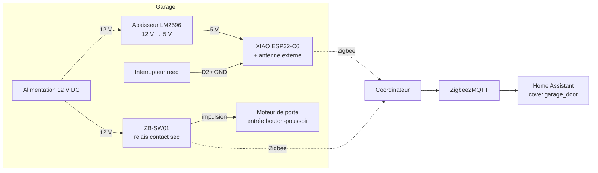

<div align="center">

# 🧲 Reed Contact Zigbee

**Soyez sûr que c'est fermé.** Un capteur d'ouverture Zigbee alimenté sur secteur qui renforce aussi votre maillage.<br>
Seeed XIAO ESP32-C6 + un interrupteur reed · prêt pour Zigbee2MQTT & Home Assistant · flashable depuis votre navigateur.

[](https://github.com/mmornati/reed-contact-zigbee/actions/workflows/ci.yml)
[](https://mmornati.github.io/reed-contact-zigbee/?lang=fr)
[](https://github.com/mmornati/reed-contact-zigbee/releases)
[](LICENSE)
<br>
[](https://wiki.seeedstudio.com/xiao_esp32c6_getting_started/)
[](https://www.zigbee2mqtt.io/)
[](https://www.home-assistant.io/)

[**🌐 Site web**](https://mmornati.github.io/reed-contact-zigbee/?lang=fr) · [**⚡ Flasher depuis le navigateur**](https://mmornati.github.io/reed-contact-zigbee/?lang=fr#flash) · [**📖 Guide de montage**](docs/fr/01-hardware-and-wiring.md) · [**📦 Versions**](https://github.com/mmornati/reed-contact-zigbee/releases)

🌐 [English](README.md) · **Français** · [Italiano](README.it.md)

<a href="https://mmornati.github.io/reed-contact-zigbee/?lang=fr"></a>

</div>

---

## ✨ Pourquoi celui-ci ?

Les capteurs d'ouverture sur pile envoient leur état puis se rendorment. Celui-ci reste éveillé et travaille pour le reste de votre réseau.

|   |   |
|---|---|
| 📡 **Aussi un routeur Zigbee** | Alimenté sur secteur, il relaie le trafic de tous les appareils Zigbee à proximité. Votre garage, abri de jardin ou portail a enfin une couverture solide. |
| 🛡️ **Sécurité positive par conception** | Seul un aimant en place donne *fermé*. Un fil coupé, un connecteur desserré ou un capteur mort apparaissent tous comme *ouvert*, jamais comme un faux « tout va bien ». |
| 🏠 **Natif Zigbee2MQTT & HA** | Un contact IAS Zone standard. Un convertisseur de 12 lignes et Home Assistant affiche un capteur de porte/fenêtre ordinaire. |
| 🚫 **Pas de WiFi, pas de cloud** | Ni mot de passe, ni adresse IP, ni compte d'application. Il continue de fonctionner quand votre WiFi tombe, et rien ne sort de chez vous. |
| ⚡ **Flashage depuis le navigateur** | Aucune chaîne de compilation nécessaire : branchez l'USB et installez depuis le [site web](https://mmornati.github.io/reed-contact-zigbee/?lang=fr#flash). |
| ✅ **Testé à chaque commit** | Tests unitaires, deux compilations du firmware, tests du convertisseur avec la propre bibliothèque de Z2M, et le vérificateur de configuration de Home Assistant. |

## 🧭 Où l'utiliser

Partout où un aimant peut passer devant un interrupteur reed. Le reed se fixe sur la partie fixe, l'aimant sur la partie mobile.

| Usage | Reed sur | Aimant sur | Astuce |
|---|---|---|---|
| 🚗 **Porte de garage** (guide complet ci-dessous) | Cadre ou rail | Porte | Alignez-les seulement tout en fin de course, pour détecter « pas *complètement* fermée » |
| 🚧 **Portail**, coulissant ou battant | Pilier | Vantail | Utilisez un reed prévu pour l'extérieur et étanchéifiez l'entrée du câble ; un portail bouge avec le vent, gardez donc l'anti-rebond |
| 🚪 **Porte d'entrée / de service** | Cadre | Porte | Un reed encastré (dans un trou percé) est invisible et difficile à neutraliser |
| 🪟 **Fenêtre ou velux** | Cadre | Ouvrant | Pour une fenêtre oscillo-battante, placez-le pour que « en soufflet » soit lu comme ouvert |
| 🛖 **Abri de jardin, cave, trappe de grenier** | Cadre | Porte ou trappe | Hors de portée du WiFi, mais dans le maillage Zigbee |
| 📬 **Clapet de boîte aux lettres** | Boîte | Clapet | Une ouverture *momentanée* suffit pour une automatisation « vous avez du courrier » |
| 🧊 **Frigo, congélateur coffre, coffre-fort** | Corps | Porte ou couvercle | Alertes « resté ouvert plus de N minutes » |

> Pour une simple porte, les capteurs sur pile coûtent moins cher. Construisez celui-ci si vous avez **du courant à proximité** (un moteur, une alimentation, une prise), si vous voulez un **routeur** dans un endroit isolé, s'il vous faut un **long câble** entre le reed et l'électronique, ou si vous voulez **étendre le firmware** (un second reed, un relais, une sonde de température...).

## 🚀 Démarrage rapide

1. **Câblez-le.** Reed `COM` → `GND`, reed `NO` → `D2`, 5 V sur la broche `5V` du XIAO. [Guide de câblage →](docs/fr/01-hardware-and-wiring.md)
2. **Flashez-le.** Depuis le [site web](https://mmornati.github.io/reed-contact-zigbee/?lang=fr#flash) (Chrome ou Edge), ou compilez-le vous-même :

   ```bash
   cd firmware
   pio run -t erase && pio run -t upload
   ```

3. **Ajoutez le convertisseur.** Copiez [`zigbee2mqtt/reed_contact.mjs`](zigbee2mqtt/reed_contact.mjs) dans le dossier `external_converters/` de Zigbee2MQTT et redémarrez Z2M.
4. **Appairez-le.** *Permit join* (autoriser l'appairage) dans Z2M. La LED clignote pendant la recherche et s'éteint une fois le réseau rejoint. Bougez l'aimant et regardez `contact` basculer.

<details>
<summary><b>Comment ça marche</b></summary>



| Reed | GPIO D2 | Zigbee | Z2M `contact` | HA `binary_sensor` |
|---|---|---|---|---|
| Aimant en face | `LOW` | `setClosed()` | `true` | `off` (fermé) |
| Aimant éloigné / fil coupé | `HIGH` | `setOpen()` | `false` | `on` (ouvert) |

</details>

## 🚗 Exemple concret : porte de garage

Les [guides](#-documentation) détaillent une installation complète dans un garage. Le capteur indique si la porte est **complètement fermée**. Associé à un relais Zigbee **ZB-SW01** sur l'entrée bouton-poussoir du moteur, un [package Home Assistant](homeassistant/garage_door.yaml) tout prêt vous donne :

- 🔘 un vrai **`cover.garage_door`** avec boutons d'ouverture/fermeture,
- 🔒 **fermer et vérifier** : demande au moteur de fermer, puis vérifie que la porte s'est vraiment fermée en moins de 90 s,
- ⏱️ une **alerte de porte restée ouverte** après N minutes (réglable depuis le tableau de bord),
- 🌙 une **vérification nocturne à 22 h**,
- 📴 une alerte si le **capteur passe hors ligne**.



Pour tout autre usage, suivez les mêmes guides en sautant les parties sur la motorisation et le `cover`.

## 🧰 Liste du matériel

Environ **15 €** de composants, plus une alimentation 5–24 V que vous avez souvent déjà à proximité.

| Composant | Rôle | Remarques |
|---|---|---|
| Seeed XIAO ESP32-C6 | Radio Zigbee + MCU | Dispose d'un connecteur U.FL ; le firmware bascule sur l'antenne externe |
| Antenne U.FL 2,4 GHz | Portée depuis l'intérieur d'un boîtier | Facultative mais recommandée |
| Interrupteur reed (NO/NC) + aimant | Le capteur | Câblez `COM` + **`NO`** : fermé uniquement avec l'aimant en face |
| Abaisseur réglable LM2596 | 12–24 V → 5 V | **Réglez-le sur 5,0 V avant de brancher le XIAO** |
| Boîtier IP65/67 + presse-étoupes | Boîtier | Le plastique ABS ne bloque pas le Zigbee |
| Résistance 10 kΩ + condensateur 100 nF | Signal propre sur les longs câbles | Quelques centimes, vivement recommandé |
| Câble à paire torsadée | Du reed au boîtier | Blindé s'il passe à côté d'un moteur |
| *Exemple garage uniquement :* relais ZB-SW01 | Envoie l'impulsion au moteur de porte | Fonctionne de 5 à 32 V DC |

## 📖 Documentation

| | Guide | Contenu |
|---|---|---|
| 01 | [Matériel et câblage](docs/fr/01-hardware-and-wiring.md) | Options d'alimentation, NO ou NC, schéma de câblage, tableau des connexions |
| 02 | [Montage pas à pas](docs/fr/02-build-guide.md) | Test sur l'établi d'abord, boîtier, placement du reed, vérifications finales |
| 03 | [Firmware](docs/fr/03-firmware.md) | PlatformIO ou Arduino IDE, flashage, réinitialisation d'usine, paramètres |
| 04 | [Zigbee2MQTT & Home Assistant](docs/fr/04-zigbee2mqtt-and-home-assistant.md) | Convertisseur, appairage, entités, le package garage |
| 05 | [Dépannage](docs/fr/05-troubleshooting.md) | Symptômes, causes et solutions |

## 🤔 FAQ

<details>
<summary><b>Pourquoi Zigbee et pas WiFi / ESPHome ?</b></summary>

Pour un simple contact, Zigbee l'emporte : il rejoint le maillage que vos autres capteurs utilisent déjà, ne demande aucun identifiant, survit aux coupures du WiFi et, étant alimenté sur secteur, ajoute un routeur là où il en faut généralement un.

| Ce que vous perdez (par rapport à WiFi + ESPHome) | Impact |
|---|---|
| Mises à jour OTA par WiFi | Mises à jour par USB. Rare pour un appareil qu'on installe une fois |
| Interface web et logs réseau | Logs sur le moniteur série USB |
| Découverte sans configuration | Un convertisseur Z2M de 12 lignes (fourni et testé) |

</details>

<details>
<summary><b>Pourquoi Arduino et pas ESP-IDF ?</b></summary>

Les deux utilisent la même pile Zigbee d'Espressif. Avec Arduino, ce capteur tient en ~200 lignes lisibles, ce qui le rend facile à forker. ESP-IDF devient rentable pour des clusters Zigbee personnalisés, une optimisation de la batterie au µA près, ou un produit commercial.

</details>

<details>
<summary><b>Peut-il fonctionner sur batterie ?</b></summary>

Ce serait possible, en tant que sleepy end device (appareil terminal en veille), mais il ne routerait plus et les capteurs commerciaux sur pile sont moins chers. Ce projet vise les endroits où le courant est à portée de main et où un routeur est le bienvenu.

</details>

## 🧪 Qualité

Chaque push et pull request lance la [CI](.github/workflows/ci.yml) :

| Vérification | Ce qu'elle prouve |
|---|---|
| **Tests unitaires** (`pio test -e native`) | Logique d'anti-rebond, de heartbeat et de débordement de `millis()`, sur la machine hôte |
| **Compilation PlatformIO** | Le firmware compile pour le XIAO ESP32-C6 en mode routeur Zigbee |
| **Compilation Arduino CLI** | Le même sketch fonctionne toujours pour les utilisateurs d'Arduino IDE |
| **Tests du convertisseur** | La propre bibliothèque `zigbee-herdsman-converters` de Z2M reconnaît l'appareil et décode correctement ouvert/fermé ; la chaîne de modèle correspond au firmware |
| **Vérification Home Assistant** | Le package passe le `check_config` de Home Assistant |
| **Liens de la doc** | Aucun lien cassé entre les guides |

Taguez une version (`git tag v1.0.0 && git push --tags`) et le [workflow de release](.github/workflows/release.yml) publie les binaires du firmware avec leurs sommes de contrôle. Le [site web](https://mmornati.github.io/reed-contact-zigbee/?lang=fr) est reconstruit avec le dernier firmware à chaque modification.

## 🗂️ Organisation du dépôt

```
firmware/
  platformio.ini              build settings (board, Zigbee router mode, tests)
  reed_contact/reed_contact.ino   the sketch
  reed_contact/contact_logic.h    debounce + heartbeat logic (unit tested)
  test/                       host unit tests
zigbee2mqtt/
  reed_contact.mjs            Zigbee2MQTT external converter
  test/                       converter integration tests
homeassistant/
  garage_door.yaml            HA package for the garage example
  ci/                         Home Assistant config check
site/                         the GitHub Pages website + browser flasher
docs/                         build guides
```

## 🤝 Contribuer

Vous en avez construit un pour un portail, une boîte aux lettres ou quelque chose d'inattendu ? Idées, corrections et photos sont les bienvenues. Ouvrez une issue ou une pull request.

## 📄 Licence

[MIT](LICENSE) © Marco Mornati. Sans lien avec Seeed Studio, Espressif, Zigbee2MQTT ou Home Assistant.
