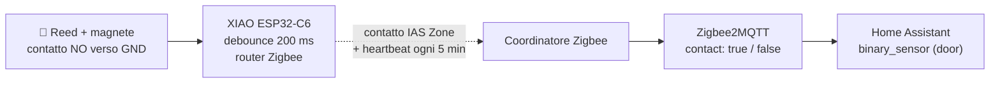
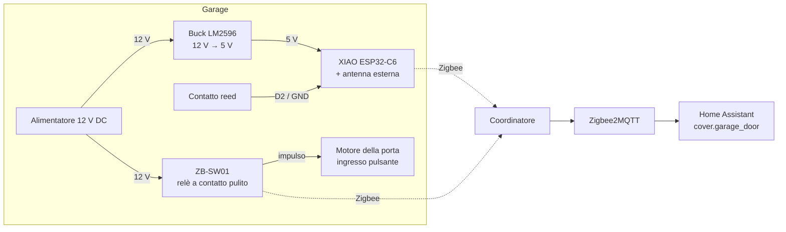

<div align="center">

# 🧲 Reed Contact Zigbee

**Sicuro che sia chiuso.** Un sensore di contatto Zigbee alimentato da rete che rinforza anche la tua mesh.<br>
Seeed XIAO ESP32-C6 + un contatto reed · pronto per Zigbee2MQTT e Home Assistant · lo flashi dal browser.

[](https://github.com/mmornati/reed-contact-zigbee/actions/workflows/ci.yml)
[](https://mmornati.github.io/reed-contact-zigbee/?lang=it)
[](https://github.com/mmornati/reed-contact-zigbee/releases)
[](LICENSE)
<br>
[](https://wiki.seeedstudio.com/xiao_esp32c6_getting_started/)
[](https://www.zigbee2mqtt.io/)
[](https://www.home-assistant.io/)

[**🌐 Sito web**](https://mmornati.github.io/reed-contact-zigbee/?lang=it) · [**⚡ Flash dal browser**](https://mmornati.github.io/reed-contact-zigbee/?lang=it#flash) · [**📖 Guida alla costruzione**](docs/it/01-hardware-and-wiring.md) · [**📦 Release**](https://github.com/mmornati/reed-contact-zigbee/releases)

🌐 [English](README.md) · [Français](README.fr.md) · **Italiano**

<a href="https://mmornati.github.io/reed-contact-zigbee/?lang=it"></a>

</div>

---

## ✨ Perché proprio questo?

I sensori di contatto a batteria inviano lo stato e tornano a dormire. Questo invece resta sempre acceso e lavora per il resto della tua rete.

|   |   |
|---|---|
| 📡 **Anche un router Zigbee** | Alimentato da rete, quindi inoltra il traffico di tutti i dispositivi Zigbee vicini. Il garage, la casetta degli attrezzi o il cancello hanno finalmente una copertura solida. |
| 🛡️ **Sicuro per progetto** | Solo un magnete al suo posto viene letto come *chiuso*. Un filo tagliato, un connettore allentato o un sensore guasto risultano tutti *aperto*, mai un falso "tutto ok". |
| 🏠 **Nativo per Zigbee2MQTT e HA** | Un normale contatto IAS Zone. Un converter di 12 righe e Home Assistant mostra un classico sensore porta/finestra. |
| 🚫 **Niente WiFi, niente cloud** | Niente password, IP o account su app. Continua a funzionare quando il WiFi non va, e nulla esce da casa tua. |
| ⚡ **Flash dal browser** | Non serve nessuna toolchain: collega l'USB e installa dal [sito web](https://mmornati.github.io/reed-contact-zigbee/?lang=it#flash). |
| ✅ **Testato a ogni commit** | Unit test, due build del firmware, test del converter con la libreria stessa di Z2M e il controllo di configurazione di Home Assistant. |

## 🧭 Dove puoi usarlo

Ovunque un magnete possa muoversi davanti a un contatto reed. Il reed va sulla parte fissa, il magnete su quella mobile.

| Uso | Reed su | Magnete su | Consiglio |
|---|---|---|---|
| 🚗 **Porta del garage** (guida completa più sotto) | Telaio o binario | Porta | Allineali solo a fine corsa, così rilevi il "non *completamente* chiuso" |
| 🚧 **Cancello**, scorrevole o a battente | Pilastro | Anta | Usa un reed per esterni e sigilla l'ingresso del cavo; i cancelli si muovono col vento, quindi tieni il debounce |
| 🚪 **Porta d'ingresso / sul retro** | Telaio | Porta | Un reed da incasso (in un foro) è invisibile e difficile da manomettere |
| 🪟 **Finestra o lucernario** | Telaio | Anta | Su una finestra a battente e ribalta, posizionalo in modo che "a ribalta" risulti aperta |
| 🛖 **Casetta, cantina, botola della soffitta** | Telaio | Porta o botola | Fuori portata del WiFi, ma dentro la mesh Zigbee |
| 📬 **Sportello della cassetta postale** | Cassetta | Sportello | Basta un *aperto* momentaneo per un'automazione "è arrivata la posta" |
| 🧊 **Frigo, congelatore a pozzetto, cassaforte** | Corpo | Porta o coperchio | Avvisi "lasciato aperto per più di N minuti" |

> Per una semplice porta i sensori a batteria costano meno. Costruisci questo quando hai **corrente vicino** (un motore, un alimentatore, una presa), vuoi un **router** in un punto isolato, ti serve un **cavo lungo** tra reed ed elettronica, o vuoi **estendere il firmware** (un secondo reed, un relè, una sonda di temperatura...).

## 🚀 Avvio rapido

1. **Collegalo.** `COM` del reed → `GND`, `NO` del reed → `D2`, 5 V sul pin `5V` dello XIAO. [Guida ai collegamenti →](docs/it/01-hardware-and-wiring.md)
2. **Flashalo.** Dal [sito web](https://mmornati.github.io/reed-contact-zigbee/?lang=it#flash) (Chrome o Edge), oppure compilalo tu:

   ```bash
   cd firmware
   pio run -t erase && pio run -t upload
   ```

3. **Aggiungi il converter.** Copia [`zigbee2mqtt/reed_contact.mjs`](zigbee2mqtt/reed_contact.mjs) nella cartella `external_converters/` di Zigbee2MQTT e riavvia Z2M.
4. **Abbinalo.** *Permit join* (consenti l'accesso) in Z2M. Il LED lampeggia mentre cerca la rete e si spegne una volta collegato. Muovi il magnete e guarda `contact` cambiare.

<details>
<summary><b>Come funziona</b></summary>



| Reed | GPIO D2 | Zigbee | Z2M `contact` | HA `binary_sensor` |
|---|---|---|---|---|
| Magnete davanti | `LOW` | `setClosed()` | `true` | `off` (chiuso) |
| Magnete lontano / filo tagliato | `HIGH` | `setOpen()` | `false` | `on` (aperto) |

</details>

## 🚗 Esempio pratico: porta del garage

Le [guide](#-documentazione) descrivono un'installazione completa in garage. Il sensore segnala se la porta è **completamente chiusa**. Insieme a un relè Zigbee **ZB-SW01** sull'ingresso pulsante del motore, un [package di Home Assistant](homeassistant/garage_door.yaml) già pronto ti dà:

- 🔘 una vera **`cover.garage_door`** con pulsanti apri/chiudi,
- 🔒 **chiudi e verifica**: chiede al motore di chiudere, poi controlla che la porta si sia davvero chiusa entro 90 s,
- ⏱️ un **avviso di porta lasciata aperta** dopo N minuti (regolabile dalla dashboard),
- 🌙 un **controllo notturno alle 22:00**,
- 📴 un avviso se il **sensore va offline**.



Per qualsiasi altro uso, segui le stesse guide e salta le parti sull'apriporta e sulla `cover`.

## 🧰 Distinta dei componenti

Circa **15 €** di componenti, più un alimentatore da 5–24 V che spesso hai già lì vicino.

| Componente | Ruolo | Note |
|---|---|---|
| Seeed XIAO ESP32-C6 | Radio Zigbee + MCU | Ha un connettore U.FL; il firmware passa all'antenna esterna |
| Antenna U.FL 2,4 GHz | Portata anche dentro una scatola | Facoltativa ma consigliata |
| Contatto reed (NO/NC) + magnete | Il sensore | Collega `COM` + **`NO`**: chiuso solo con il magnete davanti |
| Buck regolabile LM2596 | 12–24 V → 5 V | **Regolalo a 5,0 V prima di collegare lo XIAO** |
| Scatola IP65/67 + pressacavi | Contenitore | La plastica ABS non blocca lo Zigbee |
| Resistenza da 10 kΩ + condensatore da 100 nF | Segnale pulito su cavi lunghi | Pochi centesimi, fortemente consigliati |
| Cavo a coppia intrecciata | Dal reed alla scatola | Schermato se passa vicino a un motore |
| *Solo per l'esempio del garage:* relè ZB-SW01 | Manda l'impulso al motore della porta | Funziona da 5 a 32 V DC |

## 📖 Documentazione

| | Guida | Cosa trovi |
|---|---|---|
| 01 | [Hardware e collegamenti](docs/it/01-hardware-and-wiring.md) | Opzioni di alimentazione, NO o NC, schema di collegamento, tabella dei collegamenti |
| 02 | [Costruzione passo passo](docs/it/02-build-guide.md) | Prima il test al banco, contenitore, posizionamento del reed, controlli finali |
| 03 | [Firmware](docs/it/03-firmware.md) | PlatformIO o Arduino IDE, flash, reset di fabbrica, impostazioni |
| 04 | [Zigbee2MQTT e Home Assistant](docs/it/04-zigbee2mqtt-and-home-assistant.md) | Converter, abbinamento, entità, il package per il garage |
| 05 | [Risoluzione dei problemi](docs/it/05-troubleshooting.md) | Sintomi, cause e soluzioni |

## 🤔 FAQ

<details>
<summary><b>Perché Zigbee e non WiFi / ESPHome?</b></summary>

Per un singolo contatto vince Zigbee: entra nella mesh che usano già i tuoi altri sensori, non servono credenziali, sopravvive ai blackout del WiFi e, essendo alimentato da rete, aggiunge un router proprio dove di solito ne serve uno.

| A cosa rinunci (rispetto a WiFi + ESPHome) | Impatto |
|---|---|
| Aggiornamenti OTA via WiFi | Aggiornamenti via USB. Capita di rado per un dispositivo che installi una volta |
| Interfaccia web e log in rete | Log sul monitor seriale USB |
| Rilevamento senza configurazione | Un converter Z2M di 12 righe (incluso e testato) |

</details>

<details>
<summary><b>Perché Arduino e non ESP-IDF?</b></summary>

Entrambi usano lo stesso stack Zigbee di Espressif. Con Arduino questo sensore sta in ~200 righe leggibili, il che lo rende facile da forkare. ESP-IDF conviene per cluster Zigbee personalizzati, ottimizzazione della batteria fino ai µA o un prodotto commerciale.

</details>

<details>
<summary><b>Può funzionare a batteria?</b></summary>

Potrebbe, come sleepy end device, ma a quel punto smette di fare da router e i sensori a batteria commerciali costano meno. Questo progetto è pensato per i posti dove la corrente è a portata di mano e un router è il benvenuto.

</details>

## 🧪 Qualità

Ogni push e pull request esegue la [CI](.github/workflows/ci.yml):

| Controllo | Cosa dimostra |
|---|---|
| **Unit test** (`pio test -e native`) | La logica di debounce, heartbeat e overflow di `millis()`, sull'host |
| **Build PlatformIO** | Il firmware compila per lo XIAO ESP32-C6 in modalità router Zigbee |
| **Build Arduino CLI** | Lo stesso sketch funziona ancora per chi usa Arduino IDE |
| **Test del converter** | La libreria `zigbee-herdsman-converters` di Z2M riconosce il dispositivo e decodifica correttamente aperto/chiuso; la stringa del modello corrisponde al firmware |
| **Controllo Home Assistant** | Il package supera il `check_config` di Home Assistant |
| **Link della documentazione** | Nessun link rotto tra le guide |

Crea un tag di versione (`git tag v1.0.0 && git push --tags`) e il [workflow di release](.github/workflows/release.yml) pubblica i binari del firmware con i checksum. Il [sito web](https://mmornati.github.io/reed-contact-zigbee/?lang=it) viene ricostruito con l'ultimo firmware a ogni modifica.

## 🗂️ Struttura del repository

```
firmware/
  platformio.ini              build settings (board, Zigbee router mode, tests)
  reed_contact/reed_contact.ino   the sketch
  reed_contact/contact_logic.h    debounce + heartbeat logic (unit tested)
  test/                       host unit tests
zigbee2mqtt/
  reed_contact.mjs            Zigbee2MQTT external converter
  test/                       converter integration tests
homeassistant/
  garage_door.yaml            HA package for the garage example
  ci/                         Home Assistant config check
site/                         the GitHub Pages website + browser flasher
docs/                         build guides
```

## 🤝 Contribuire

Ne hai costruito uno per un cancello, una cassetta postale o qualcosa di inaspettato? Idee, correzioni e foto sono benvenute. Apri una issue o una pull request.

## 📄 Licenza

[MIT](LICENSE) © Marco Mornati. Non affiliato a Seeed Studio, Espressif, Zigbee2MQTT o Home Assistant.
