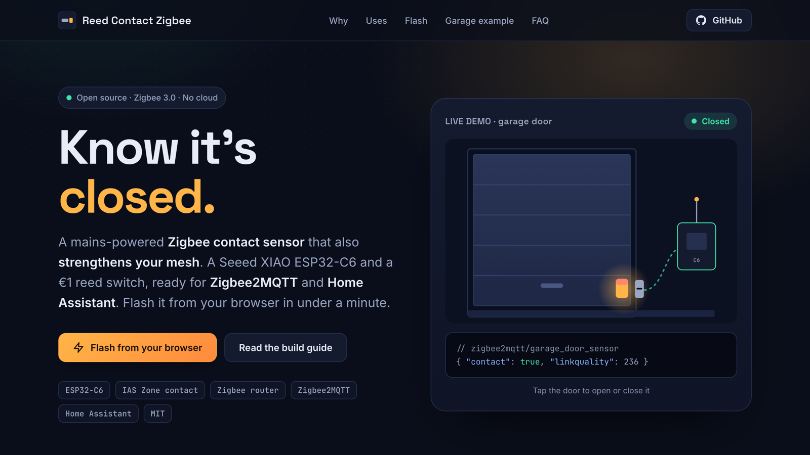
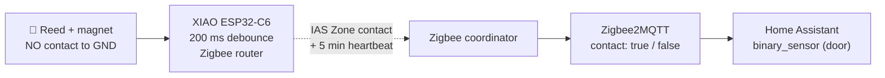
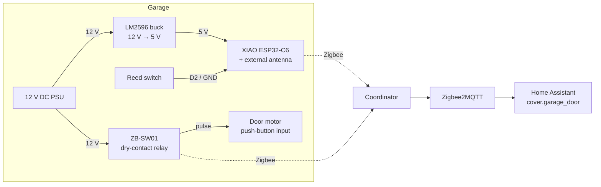

<div align="center">

# 🧲 Reed Contact Zigbee

**Know it's closed.** A mains-powered Zigbee contact sensor that also strengthens your mesh.<br>
Seeed XIAO ESP32-C6 + a reed switch · Zigbee2MQTT & Home Assistant ready · flash it from your browser.

[](https://github.com/mmornati/reed-contact-zigbee/actions/workflows/ci.yml)
[](https://mmornati.github.io/reed-contact-zigbee/)
[](https://github.com/mmornati/reed-contact-zigbee/releases)
[](LICENSE)
<br>
[](https://wiki.seeedstudio.com/xiao_esp32c6_getting_started/)
[](https://www.zigbee2mqtt.io/)
[](https://www.home-assistant.io/)

[**🌐 Website**](https://mmornati.github.io/reed-contact-zigbee/) · [**⚡ Flash in your browser**](https://mmornati.github.io/reed-contact-zigbee/#flash) · [**📖 Build guide**](docs/01-hardware-and-wiring.md) · [**📦 Releases**](https://github.com/mmornati/reed-contact-zigbee/releases)

🌐 **English** · [Français](README.fr.md) · [Italiano](README.it.md)

<a href="https://mmornati.github.io/reed-contact-zigbee/"></a>

</div>

---

## ✨ Why this one?

Battery contact sensors report and go back to sleep. This one stays awake and works for the rest of your network.

|   |   |
|---|---|
| 📡 **A Zigbee router, too** | Mains powered, so it relays traffic for every Zigbee device nearby. Your garage, shed or gate finally gets solid coverage. |
| 🛡️ **Fail-safe by design** | Only a magnet in place reads *closed*. A cut wire, a loose connector or a dead sensor all show up as *open*, never as a false "all good". |
| 🏠 **Zigbee2MQTT & HA native** | A standard IAS Zone contact. One 12-line converter and Home Assistant shows a normal door/window sensor. |
| 🚫 **No WiFi, no cloud** | No passwords, IPs or app accounts. It keeps working when your WiFi doesn't, and nothing leaves your house. |
| ⚡ **Flash from the browser** | No toolchain needed: plug in USB and install from the [website](https://mmornati.github.io/reed-contact-zigbee/#flash). |
| ✅ **Tested on every commit** | Unit tests, two firmware builds, converter tests against Z2M's own library, and Home Assistant's config checker. |

## 🧭 Where you can use it

Anywhere a magnet can move in front of a reed switch. The reed goes on the fixed part, the magnet on the moving part.

| Use | Reed on | Magnet on | Tip |
|---|---|---|---|
| 🚗 **Garage door** (full guide below) | Frame or rail | Door | Align them only at the very end of travel, to detect "not *fully* closed" |
| 🚧 **Gate**, sliding or swing | Post | Gate leaf | Use an outdoor-rated reed and seal the cable entry; gates move in the wind, so keep the debounce |
| 🚪 **Front / back door** | Frame | Door | A recessed reed (drilled in) is invisible and hard to tamper with |
| 🪟 **Window or skylight** | Frame | Sash | For a tilt-and-turn window, place it so "tilted" reads as open |
| 🛖 **Shed, cellar, attic hatch** | Frame | Door or hatch | Out of WiFi range, inside the Zigbee mesh |
| 📬 **Mailbox flap** | Box | Flap | A momentary *open* is enough for a "you've got mail" automation |
| 🧊 **Fridge, chest freezer, safe** | Body | Door or lid | "Left open for more than N minutes" alerts |

> Battery sensors are cheaper for a simple door. Build this one when you have **power nearby** (a motor, a PSU, a socket), want a **router** in a remote spot, need a **long cable** between reed and electronics, or want to **extend the firmware** (a second reed, a relay, a temperature probe...).

## 🚀 Quick start

1. **Wire it.** Reed `COM` → `GND`, reed `NO` → `D2`, 5 V into the XIAO's `5V` pin. [Wiring guide →](docs/01-hardware-and-wiring.md)
2. **Flash it.** From the [website](https://mmornati.github.io/reed-contact-zigbee/#flash) (Chrome or Edge), or build it yourself:

   ```bash
   cd firmware
   pio run -t erase && pio run -t upload
   ```

   Prefer ESPHome? Flash [`esphome/reed-contact.yaml`](esphome/reed-contact.yaml) instead, same wiring. [How it differs →](docs/03-firmware.md#option-c-esphome)

3. **Add the converter.** Copy [`zigbee2mqtt/reed_contact.mjs`](zigbee2mqtt/reed_contact.mjs) to Zigbee2MQTT's `external_converters/` folder and restart Z2M (for the ESPHome build: [`reed_contact_esphome.mjs`](zigbee2mqtt/reed_contact_esphome.mjs)).
4. **Pair it.** *Permit join* in Z2M. The LED blinks while searching and turns off once joined. Move the magnet and watch `contact` flip.

<details>
<summary><b>How it works</b></summary>



| Reed | GPIO D2 | Zigbee | Z2M `contact` | HA `binary_sensor` |
|---|---|---|---|---|
| Magnet in front | `LOW` | `setClosed()` | `true` | `off` (closed) |
| Magnet away / wire cut | `HIGH` | `setOpen()` | `false` | `on` (open) |

</details>

## 🚗 Worked example: garage door

The [guides](#-documentation) walk through a complete garage install. The sensor reports whether the door is **fully closed**. Together with a **ZB-SW01** Zigbee relay on the motor's push-button input, a ready-made [Home Assistant package](homeassistant/garage_door.yaml) gives you:

- 🔘 a real **`cover.garage_door`** with open/close buttons,
- 🔒 **close & verify**: asks the motor to close, then checks the door really shut within 90 s,
- ⏱️ a **left-open alert** after N minutes (adjustable from the dashboard),
- 🌙 a **22:00 night check**,
- 📴 an alert if the **sensor goes offline**.



For any other use, follow the same guides and skip the opener and `cover` parts.

## 🧰 Bill of materials

About **€15** of parts, plus a 5–24 V supply you often already have nearby.

| Part | Role | Notes |
|---|---|---|
| Seeed XIAO ESP32-C6 | Zigbee radio + MCU | Has a U.FL connector; the firmware switches to the external antenna |
| 2.4 GHz U.FL antenna | Range from inside a box | Optional but recommended |
| Reed switch (NO/NC) + magnet | The sensor | Wire `COM` + **`NO`**: closed only with the magnet in front |
| LM2596 adjustable buck | 12–24 V → 5 V | **Set it to 5.0 V before connecting the XIAO** |
| IP65/67 box + cable glands | Enclosure | ABS plastic doesn't block Zigbee |
| 10 kΩ resistor + 100 nF capacitor | Clean signal on long cables | A few cents, strongly recommended |
| Twisted-pair cable | Reed to box | Shielded if it runs next to a motor |
| *Garage example only:* ZB-SW01 relay | Pulses the door motor | Runs from 5–32 V DC |

## 📖 Documentation

| | Guide | What's inside |
|---|---|---|
| 01 | [Hardware & wiring](docs/01-hardware-and-wiring.md) | Power options, NO vs NC, wiring diagram, connection table |
| 02 | [Step-by-step build](docs/02-build-guide.md) | Bench test first, enclosure, reed placement, final checks |
| 03 | [Firmware](docs/03-firmware.md) | PlatformIO, Arduino IDE or ESPHome, flashing, factory reset, settings |
| 04 | [Zigbee2MQTT & Home Assistant](docs/04-zigbee2mqtt-and-home-assistant.md) | Converter, pairing, entities, the garage package |
| 05 | [Troubleshooting](docs/05-troubleshooting.md) | Symptoms, causes and fixes |
| 06 | [Soldering the XIAO](docs/06-soldering.md) | Tools, temperatures, perfboard layout, checks before power, common bad joints |

## 🤔 FAQ

<details>
<summary><b>Why Zigbee and not WiFi / ESPHome?</b></summary>

For a single contact, Zigbee wins: it joins the mesh your other sensors already use, needs no credentials, survives WiFi outages and, being mains powered, adds a router where you usually need one.

| You give up (vs WiFi + ESPHome) | Impact |
|---|---|
| OTA updates over WiFi | Updates over USB. Rare for a device you install once |
| Web UI and network logs | Logs on the USB serial monitor |
| Zero-config discovery | A 12-line Z2M converter (included and tested) |

Like ESPHome but want Zigbee? ESPHome now runs on Zigbee too: [`esphome/reed-contact.yaml`](esphome/reed-contact.yaml) is the same sensor in YAML, with the same wiring. It reports a Binary Input instead of an IAS Zone and needs ESPHome's `dev` branch. See [Option C](docs/03-firmware.md#option-c-esphome).

</details>

<details>
<summary><b>Why Arduino and not ESP-IDF?</b></summary>

Both run the same Espressif Zigbee stack. Arduino gets this sensor done in ~200 readable lines, which makes it easy to fork. ESP-IDF pays off for custom Zigbee clusters, battery tuning down to the µA, or a commercial product.

</details>

<details>
<summary><b>Can it run on a battery?</b></summary>

It could, as a sleepy end device, but then it stops routing and commercial battery sensors are cheaper. This project is for places where power is close by and a router is welcome.

</details>

## 🧪 Quality

Every push and pull request runs [CI](.github/workflows/ci.yml):

| Check | What it proves |
|---|---|
| **Unit tests** (`pio test -e native`) | Debounce, heartbeat and `millis()` rollover logic, on the host |
| **PlatformIO build** | The firmware compiles for the XIAO ESP32-C6 in Zigbee router mode |
| **Arduino CLI build** | The same sketch still works for Arduino IDE users |
| **Converter tests** | Z2M's own `zigbee-herdsman-converters` resolves the device and decodes open/closed correctly; the model string matches the firmware |
| **Home Assistant check** | The package passes Home Assistant's own `check_config` |
| **Docs links** | No broken links between guides |

Tag a version (`git tag v1.0.0 && git push --tags`) and the [release workflow](.github/workflows/release.yml) publishes firmware binaries with checksums. The [website](https://mmornati.github.io/reed-contact-zigbee/) is rebuilt with the latest firmware on every change.

## 🗂️ Repository layout

```
firmware/
  platformio.ini              build settings (board, Zigbee router mode, tests)
  reed_contact/reed_contact.ino   the sketch
  reed_contact/contact_logic.h    debounce + heartbeat logic (unit tested)
  test/                       host unit tests
esphome/
  reed-contact.yaml           the same sensor as ESPHome YAML (alternative firmware)
zigbee2mqtt/
  reed_contact.mjs            Zigbee2MQTT external converter
  reed_contact_esphome.mjs    converter for the ESPHome build
  test/                       converter integration tests
homeassistant/
  garage_door.yaml            HA package for the garage example
  ci/                         Home Assistant config check
site/                         the GitHub Pages website + browser flasher
docs/                         build guides
```

## 🤝 Contributing

Built one for a gate, a mailbox or something unexpected? Ideas, fixes and photos are welcome. Open an issue or a pull request.

## 📄 License

[MIT](LICENSE) © Marco Mornati. Not affiliated with Seeed Studio, Espressif, Zigbee2MQTT or Home Assistant.
